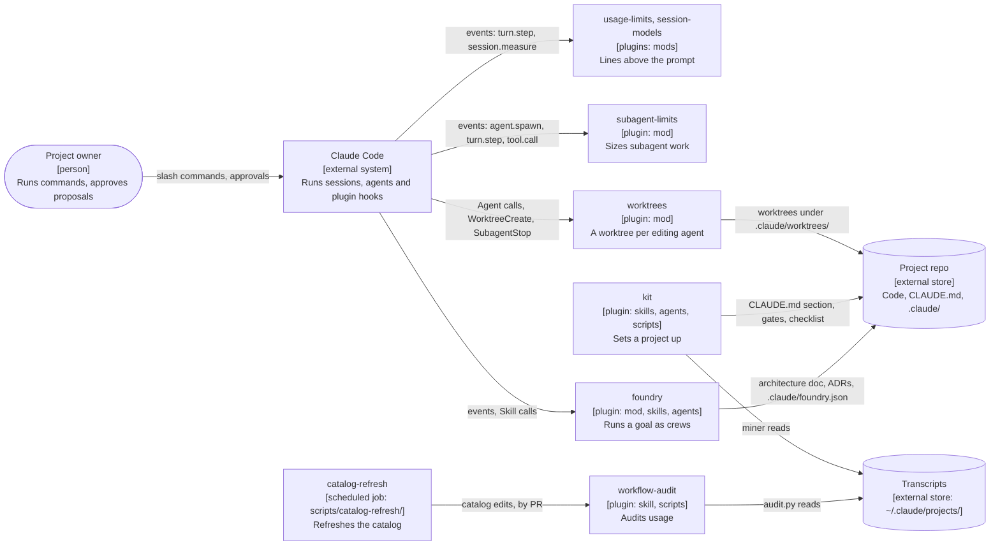
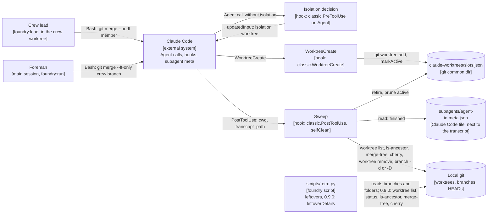
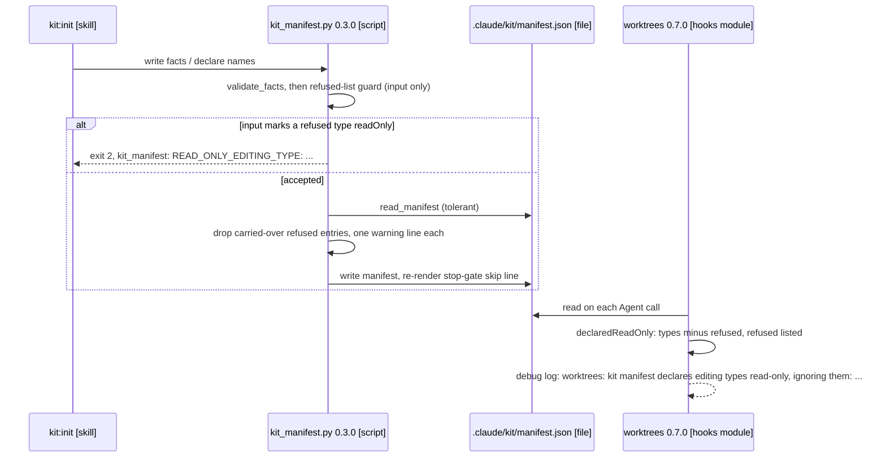
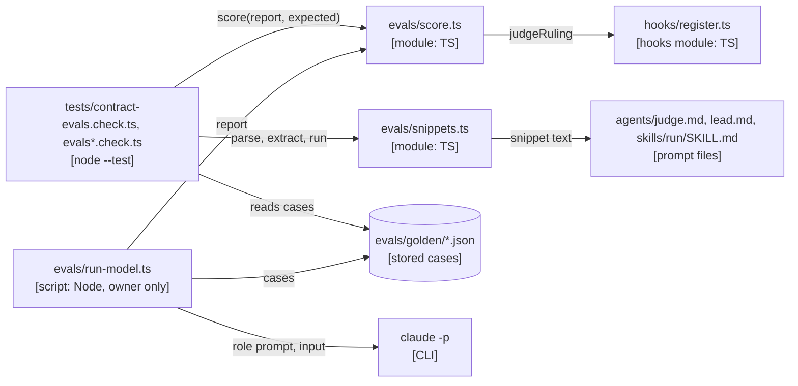
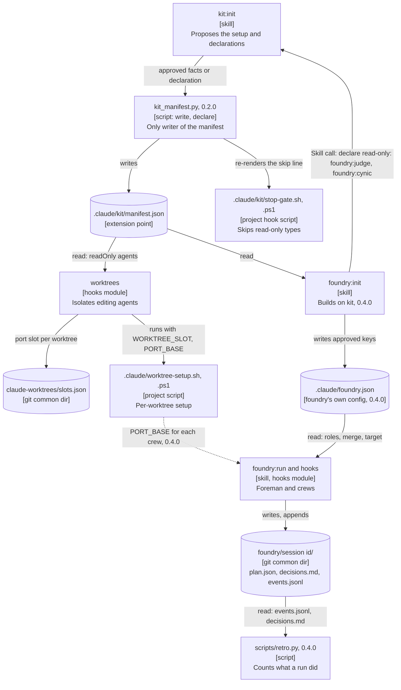

# claude-ops architecture

This repo is the `claude-ops` plugin marketplace for Claude Code: seven plugins under `plugins/<name>/`, listed in `.claude-plugin/marketplace.json`, plus one scheduled job under `scripts/`. Each plugin installs on its own. This doc covers the repo as a whole: the principles every change is held to, what each module owns, the seams between modules, and the decisions behind them.

foundry has its own, deeper module doc: [`plugins/foundry/docs/architecture.md`](../plugins/foundry/docs/architecture.md), with [foundry ADR-0001](../plugins/foundry/docs/adr/0001-design-phase.md) (the design phase, principle packs and plan file). That doc stays the source for foundry's internals; this one links to it rather than repeating it. Repo-level ADRs are in [`docs/adr/`](adr/) and are cited here as ADR-00NN; foundry's own is always written "foundry ADR-0001".

Recorded on 2026-10-26 from the code at commit `0954e71`. foundry run 2's design crew added the extension framework on 2026-10-26, against `b665583`: [ADR-0012](adr/0012-extension-framework.md) and the ADRs that apply it, accepted on 2026-10-27. Where this doc says kit 0.2.0, worktrees 0.6.0 or foundry 0.4.0, it describes that design; the code catches up when the run's wave 1 merges. `.claude/worktrees/` holds agent worktrees and is not part of the repo; `plugins/context-limits/` is an untracked, ignored leftover with no tracked files and no marketplace entry, and is not a module.

## Principles

These are foundry's principle packs, adopted and adapted to this repo. Each principle has a test a reviewer can check against a diff. Where a principle and a pack default differ, the principle here wins; a pack rule listed as dropped stays dropped.

Packs loaded: `core`, `library`, `ai`, `frontend`, `data`.

- `service`: not loaded. Nothing here serves requests; the hooks modules run inside the user's Claude Code process, one event at a time.
- `infra`: not loaded. There is no Terraform, Kubernetes, Dockerfile, IAM policy or CI workflow in the repo. The one scheduled job, `scripts/catalog-refresh/run.sh`, is covered by P20 and ADR-0010.

What the terms mean here: a **module** is a plugin directory, plus the marketplace root and the catalog-refresh job (see the module map). A plugin's **public surface** is what a user or another plugin can name: its skills, agent types, slash commands, `userConfig` keys, the files it writes into a project or reads from one, and the files under the git common dir it shares. Its hooks module's exported functions are a test seam, not public surface.

### Core

- **P1. Plugins never import each other.** (core 1) A plugin cooperates with another only through the channels in ADR-0001: agent-type names, files in the project, Claude Code events, and skills by name. Within a plugin, tests import from `hooks/register.ts(x)` or the script they test.
  Test: no import, `require`, Python `import` or file read in the diff reaches into another `plugins/<name>/` directory, except kit's vendored-copy test (ADR-0003).
- **P2. New files go in the module that owns the job.** (core 2) Test: every new path sits under a module's owned paths in the module map, and that module's job covers it.
- **P3. Decisions are pure functions; handlers do the I/O.** (core 4, adapted) A hooks module exports each decision as a function of plain values, and the `on(...)` handlers gather facts through `$` and act (ADR-0002). Python scripts keep the same split between parsing and metric functions.
  Test: a new rule in a hooks module is an exported function with no `$` parameter, and a test in `tests/` calls it directly.
- **P4. Every seam has a written contract.** (core 5) The seams table below names each one's contract file.
  Test: a diff that changes what crosses a seam updates its contract (`plan.schema.json`, `CONTRACT.md`, the worktrees README contract table, a `types/index.d.ts`, a script's docstring) in the same change.
- **P5. Check inputs at the boundary; gating hooks fail open.** (core 6, adapted) Values from `userConfig`, hook events, `plan.json` and transcripts are checked where they arrive (`setting()` in subagent-limits, `noIsolateTypes()` in worktrees, `parsePlan()` in foundry). A hook that refuses or rewrites calls wraps each handler so a thrown error is logged to the debug log and the call goes through (ADR-0008).
  Test: each new `on(...)` handler in foundry or worktrees ends in `.catch(failOpen)` or `.catch(passThrough)`, and no `catch` in the diff drops an error without logging it or saying in a comment why the fallback is safe.
- **P6. Anything that may run twice is idempotent.** (core 7) Worktree creation reuses an existing path or branch (`planCreate`), slot allocation runs under a lock, the parse cache skips unchanged files, and the catalog refresh skips while last week's PR is open.
  Test: a new write, hook or job that can repeat (a reload, a retried hook, a second session) checks before it writes, and a test runs it twice.
- **P7. Hooks say what they did, under the plugin's prefix.** (core 8, adapted) There is no metrics backend: a hook reports through `$.ui.log(..., { to: 'debug' })`, a toast, or a note on the tool result, prefixed with the plugin's marker (`[foundry]`, `[subagent-limits]`).
  Test: each new refusal, error branch and external command in a hooks module logs or notes with the plugin's prefix.
- **P8. No secrets or transcript content in logs, reports or fixtures.** (core 9, with data 14) Scripts redact before printing (`wa_common.redact`); test fixtures are synthetic, never real transcripts.
  Test: grep the diff for keys, tokens and raw transcript text in prints, logs, toasts and `tests/fixtures/`; none appear.
- **P9. New behaviour that widens access defaults off.** (core 10, adapted) A new `userConfig` option keeps the current behaviour by default, and anything that grants more defaults to deny (`isolateNestedRepos` defaults false; the catalog refresh allows edits only under the catalog).
  Test: each new `userConfig` default in the diff reproduces the previous behaviour, and each new allowed tool, path or permission is the narrowest that works.
  Amended for foundry 0.8.0, accepted by the owner with [foundry ADR-0005](../plugins/foundry/docs/adr/0005-growth-model.md) on 2026-10-29: the architect and the writer get `WebFetch` and `WebSearch` on by default (its section 3), and fetches pass no allowlist today (section 11). The narrowing point is foundry's `fetchVerdict` hook, which sees every web fetch in the session and is where a guardrail goes later.
- **P10. No secrets in source.** (core 11) Test: `gitleaks detect`, or a grep for key patterns, finds nothing new. The untracked `.env` at the root stays untracked.
- **P11. Build for a current caller.** (core 12) Test: every new option, extension point or exported function has a caller in the same diff or in existing code (tests count only for a test seam).
- **P12. A behaviour change ships with a test that fails without it.** (core 13) Tests run with `claude plugin test plugins/<name>` for the mods and `python -m unittest discover -s plugins/<name>/tests` for kit and workflow-audit (root `README.md`, "Develop"), `node --test plugins/foundry/tests/packs.check.ts` for foundry's principle packs, and `node --test plugins/foundry/tests/contract-evals.check.ts plugins/foundry/tests/evals*.check.ts` for foundry's evals ([foundry ADR-0007](../plugins/foundry/docs/adr/0007-behaviour-evals.md)). The evals command names its files on purpose: during a run, the `tests/*.check.ts` glob also picks up contract checks that are red by design.
  Test: the diff adds or changes a test under the plugin's `tests/`, and reverting the source change makes it fail.
- **P13. Dead code goes in the change that kills it.** (core 14) A renamed user setting is the exception: the old name keeps working, marked deprecated (P17).
  Test: no function, file, constant or setting the diff stops using is left behind, unless it is a documented deprecated alias.

Dropped: core 3 (interfaces at module edges). No module passes objects across a plugin boundary, and handlers already depend on the mod API's `EngineInterface` type rather than a concrete class.

### Library

The plugins are what other people install. They are not imported as code, so the library pack applies to each plugin's public surface rather than to an exports map.

- **P14. A plugin's public surface is declared in its manifest and README.** (library 1 and 13, adapted) `plugin.json` declares the name, version and `userConfig`; the plugin's README names every skill, agent type, command and project file it writes or reads.
  Test: each new skill, agent, command, `userConfig` key or project file in the diff appears in the plugin's README, and `claude plugin validate plugins/<name>` passes.
- **P15. A file another plugin reads is public surface.** (library 1 and 2, adapted) The producer documents it and its shape; anything else (script output read only by the same plugin's skill, internal docs such as workflow-audit's `CONTRACT.md`, "internal contract") is internal.
  Test: a diff that makes one plugin read a file another plugin writes adds that file's contract to the producer's README or docs, and a row to the seams table here.
- **P16. Versions follow semver per plugin, and every shipped change moves the version.** (library 3 and 4, adapted; ADR-0009) Breaking means: renaming or removing a skill, agent type, command, `userConfig` key, project-file contract or setup-script variable, or reading a stored shape the old way no longer can.
  Test: a diff that changes a plugin's behaviour bumps its `plugin.json` version, major (or minor while below 1.0) for a breaking change, minor for a feature, patch for a fix.
- **P17. Deprecate before removing.** (library 6, adapted) Test: a renamed setting or agent type keeps the old name working and says it is deprecated in `plugin.json` or the README, as `readOnlyAgents` does.
- **P18. Loading a mod only registers handlers.** (library 7, 8 and 9, adapted) Module top level defines names; work happens in handlers. Configuration comes from `register`'s `options`, never from `process.env` or a config file read at load. Mods never exit the process.
  Test: the diff adds no I/O, timer or `process.env` read at module top level, and no `process.exit`.
- **P19. No runtime dependencies.** (library 10, made stricter; ADR-0002, ADR-0004) Mods import only `claude-code`; Python scripts use the 3.9+ standard library.
  Test: the diff adds no `package.json`, npm import, `requirements.txt` or non-stdlib Python import.
- **P33. A plugin extends another only through an extension point the base declares.** (added by ADR-0012; library 1 and 2, extended) The base writes a versioned file under a schema it owns, through code, and names it as an extension point in its README and in the seams table. Extensions read it and never edit it, adding to it only through the base's own skill and its approval step. No plugin rewrites another's prompt (`skill.prompt`, or registering another plugin's agent type), and none lists another under plugin.json `dependencies`. A declaration that relaxes a default matches the full name exactly; a missing, unreadable or unknown-version file means today's behaviour.
  Test: a diff that makes one plugin act on another's file reads a path the seams table marks as an extension point, writes nothing there, and has a test for the file being absent and corrupt; the diff adds no `skill.prompt` handler for a skill outside the plugin and no `dependencies` key.

Dropped: library 5 (changelog). The repo keeps no changelog; commit subjects carry the version (`kit 0.1.1: ...`) and READMEs describe the current behaviour. Library 11 (wrapped error types) and 12 (API report): nothing imports the plugins as code, so there is no error API or export surface to check.

### AI

Model calls here are Claude Code's own: every agent, skill and the headless catalog refresh are prompts that Claude Code runs. No plugin calls a model API directly.

- **P20. Code decides what code can decide.** (ai 9, ai 11; ADR-0008) Gates, routing, counts, limits and permissions are hooks or scripts, not prompt instructions. A model's side effects pass an allowlist or the user's approval: kit and foundry init write only after the owner sees the proposal; the catalog refresh runs with a fixed `--allowedTools` list and fails on edits outside the catalog.
  Test: no new prompt text asks the model to enforce a rule a hook could refuse, and each new headless `claude -p` call sets `--allowedTools` and a budget.
  Amended for foundry 0.8.0, accepted by the owner with [foundry ADR-0005](../plugins/foundry/docs/adr/0005-growth-model.md) on 2026-10-29: an extend pass writes domain sections and ADRs into the project's architecture doc without owner approval, as init's doc already is (its section 6); the cynic reviews each pass, and the foreman commits it on its own as `docs(arch): extend <domain>`, so one revert undoes it. Web fetches pass no allowlist today (section 11); `fetchVerdict` allows every call and logs it, and an allowlist added later is a change to that hook alone.
- **P21. Prompts live in prompt files.** (ai 4, adapted) Prompts are `agents/*.md`, `skills/*/SKILL.md` and `scripts/catalog-refresh/prompt.md`. A hooks module holds only short notes and refusals, as exported constants (`CONTRACT`, `MODEL_REFUSAL`).
  Test: the diff adds no multi-paragraph prompt inside a hooks module or script outside an exported constant.
- **P22. Every agent pins its model.** (ai 5, adapted; ADR-0011) Agent definitions set `model` by family alias (`opus`, `sonnet`, `haiku`), and foundry's crew calls set `model` and `effort`. Family aliases are deliberate; dated IDs are not used.
  Test: each new agent file has `model` in its frontmatter, and each new `Agent(...)` example in a prompt sets `model` and `effort`.
  Effort ladder (ADR-0011 amendment, 2026-10-27): judges, red teams, reviewers and writers run at Opus `medium` (a writer may run on Sonnet, or Opus `low`); `high` and `xhigh` for those roles only on the owner's explicit call. Only builders climb the ladder on failed fixes. A spent repair budget goes `BLOCKED`, never up an effort level. Test: no prompt or frontmatter in the diff sets `high` or `xhigh` as the default for a judge, red team, reviewer or writer.
- **P23. Model output that code reads has a fixed format, checked at the seam.** (ai 8) Reports start with a marker the hooks or skills parse (`CHECKPOINT:`, `BLOCKED:`, `QUESTION:`, `PROPOSAL:`, `PLAN:`, `RECOMMEND:`), and `plan.json` is validated against `plan.schema.json`.
  Test: a new report field another component reads is in the agent's report format and parsed by named code, with a defined path when it is missing.
- **P24. The model reads summaries, not raw transcripts.** (ai 12, adapted; ADR-0004) Transcript text reaches a prompt only through a script's redacted, size-bounded output.
  Test: no new skill or agent prompt tells the model to open `~/.claude/projects/**.jsonl`.
- **P25. Tests need no network and no model.** (ai 10) Test: `claude plugin test` and the unittest suites pass offline, with no API key set.
- **P26. Agent work has a budget enforced in code.** (ai 13, adapted) subagent-limits caps subagent context (`nudgeAtK`, `stopAtK`); foundry caps parallel crews (`maxParallelCrews`; the `agentCap` total was retired in 0.7.0); the catalog refresh caps spend (`BUDGET_USD`); foundry's model eval runner is bounded by its fixed case list and a per-case timeout, with no USD cap, by the owner's ruling of 2026-10-29 ([foundry ADR-0007](../plugins/foundry/docs/adr/0007-behaviour-evals.md), section 7).
  Test: a new feature that starts agents or headless runs is covered by one of these caps or adds its own, enforced by a hook or the script.
- **P34. foundry's judge and cynic prompts have a checked-in eval set and a code grader.** (ai 2 and ai 3, for `plugins/foundry/agents/judge.md` and `agents/cynic.md` only; [foundry ADR-0007](../plugins/foundry/docs/adr/0007-behaviour-evals.md)) The golden cases are `plugins/foundry/evals/golden/*.json`, one per file under `evals/case.schema.json`, each taken from a real run file and holding the `VERDICT:` or `RECOMMEND:` line it expects. A fixed judge or cynic failure adds a case. `evals/score.ts` grades in code and rules `VERDICT:` lines through the merge gate's own `judgeRuling`. `evals/snippets.ts` runs the shell snippets ADR-0007's `## Snippets` list names in a temp git repo, inside the suite. The model runner, `evals/run-model.ts`, is an optional tool the owner runs by hand; no suite or done-check runs it. No rule requires an eval run when a prompt changes.
  Test: a diff that fixes a judge or cynic ruling adds a `golden/*.json` case; a diff that moves or rewords a listed snippet updates its `## Snippets` line; `node --test plugins/foundry/tests/contract-evals.check.ts plugins/foundry/tests/evals*.check.ts` passes offline.

Dropped: ai 1 (an eval run with every prompt change), by the owner's ruling of 2026-10-29: the work targets subscription users, nothing in the suites may need a model or the owner present, and the owner runs the model evals by hand, never as a gate (foundry ADR-0007). Ai 2 and 3 for every prompt except foundry's judge and cynic (P34): the other prompts are checked by the hook tests, the wording checks and acceptance runs, as foundry's 0.3.0 commits show ("acceptance friction fixes"). Ai 6 and 7 (tracing and one client wrapper): Claude Code makes every model call and writes the transcript, which workflow-audit reads. Ai 14 (latency budget with fallback): no plugin makes a model call it could time out; foundry's 15-minute stall wake (`STALL_MS`) is the nearest thing.

### Frontend

usage-limits and session-models render one line above the prompt (`ui.render` on `AbovePrompt`, in `register.tsx`) and send toasts.

- **P27. The line uses theme colours, not raw ones.** (frontend 9, adapted) Test: no hex or `rgb()` colour in a `.tsx` file; colour comes from props such as `color="warning"` and `dimColor`.
- **P28. The rendered text is derived at render time.** (frontend 2 and 4, adapted) The render reads the mod's state and formats it with exported pure functions (`runs`, `crewsPart`); it stores no copy of a derived value and mutates nothing it is given.
  Test: the diff adds no state set only from other state, and no mutation of render props.

Dropped: frontend 1, 3, 5 to 8 and 10 to 14. There is no component tree, client state store, data fetching layer, design system, interactive element, route or browser bundle; the UI is one line of text and a toast.

### Data

workflow-audit is a small batch job: transcripts in, `metrics.json` and samples out, read by its skill. kit's miner is a smaller one.

- **P29. Stored shapes are declared and versioned.** (data 3 and 5) `metrics.json`, `experiments.json`, `catalog/practices.json` and `catalog/prices.json` are declared in `plugins/workflow-audit/CONTRACT.md`; `metrics.json` and the parse cache carry version numbers; `plan.json` has `plan.schema.json` and `version`; plugin-state types are in `types/index.d.ts` (ADR-0007). Known departure: `.claude/foundry.json` is declared (`foundry-config.schema.json`) but unversioned, since foundry 0.3.0. It gets a `version` on its first change of meaning ([foundry ADR-0002](../plugins/foundry/docs/adr/0002-kit-manifest-and-config.md), Consequences).
  Test: a diff that adds, renames or retypes a field in a stored shape updates its declaration and, for a rename or retype, its version, and keeps reading the old shape or says why not.
- **P30. Consumers read only declared fields.** (data 4) Test: a skill or hook in the diff reads no field of `metrics.json`, `plan.json` or the catalog that the contract doesn't declare.
- **P31. Raw input is read-only.** (data 6) Scripts never write to `~/.claude/projects/`; their output and caches go to their own directories (`~/.claude/workflow-audit/`).
  Test: no write path in the diff points into `~/.claude/projects/`.
- **P32. Checks gate publication.** (data 12) The catalog refresh runs the workflow-audit tests and fails before it pushes (ADR-0010).
  Test: a new job that publishes data runs its checks first and exits non-zero on failure.

Dropped: data 1, 2, 7 to 11 and 13. The audit is a personal report over "the last N days" by file mtime, not a partitioned pipeline with an orchestrator, lineage, backfills or a staging swap. Data 14 is folded into P8.

## Module map

The context diagram shows the plugins, the person who runs them and what sits around them. The table after it says what each module owns.



*The repo's context: seven plugins and one scheduled job, and what each talks to.*
Traces to: `.claude-plugin/marketplace.json`, `docs/adr/0001-self-contained-plugins.md`, `docs/adr/0010-dated-catalog-refreshed-by-pr.md`, and the module entries below.

| Module | Owns | Job |
| --- | --- | --- |
| marketplace | `.claude-plugin/marketplace.json`, `README.md`, `LICENSE`, `assets/`, `.gitignore`, `.gitattributes`, `docs/` | Lists the plugins, tells the story, holds repo-wide docs |
| usage-limits | `plugins/usage-limits/` | Line above the prompt: limit windows, burn rate, run-out projection, context fill, cost |
| session-models | `plugins/session-models/` | Line above the prompt: main model and effort, live agents by model, named crews, warnings |
| subagent-limits | `plugins/subagent-limits/` | Sizes and splits subagent work; asks a large subagent to checkpoint, then refuses its tools |
| worktrees | `plugins/worktrees/` | Worktree per editing agent (none for types kit's manifest declares read-only, 0.6.0), setup script and port slots, cleanup, `/tidy` |
| workflow-audit | `plugins/workflow-audit/` | `/workflow-audit`: script measures transcripts, skill judges against the catalog |
| catalog-refresh | `scripts/catalog-refresh/` | Weekly headless refresh of workflow-audit's catalog, by PR |
| kit | `plugins/kit/` | `/kit:init` sets a project up from its code and (0.2.0) records it in a manifest; `/kit:revise` revises it from its sessions; four model-pinned agents |
| foundry | `plugins/foundry/` | `/foundry:run` runs a goal as parallel crews; `/foundry:init` and the architect write the architecture doc and plan; (0.4.0) `/foundry:retro` counts what a run did |

Every plugin has `.claude-plugin/plugin.json` (name, version, `userConfig`) and a `README.md`. The mods (usage-limits, session-models, subagent-limits, worktrees, foundry) have `hooks/hooks.json` naming one module, `tests/`, `tsconfig.json`, and `types/index.d.ts` where they keep plugin state (ADR-0002, ADR-0007).

### marketplace

Owns the marketplace manifest and the root README. Seam: `marketplace.json` lists each plugin's `name`, `description`, `source` (`./plugins/<name>`) and `category`; versions live in each `plugin.json` (ADR-0009). Adding a plugin means a new `plugins/<name>/`, an entry here, and a README section; the README's "Develop" section lists the test commands for each plugin. From foundry run 4 it also owns `tests/e2e/`, the cross-plugin end-to-end tests run with `node --test`: `tests/e2e/cleanup.e2e.ts` drives worktrees' hooks against a real git repo in a temp dir and runs foundry's `scripts/retro.py`, asserting no leftover agent branches, folders or `active` entries ([ADR-0015](adr/0015-agent-worktree-cleanup.md)). It imports `plugins/worktrees/tests/fixtures/run3.ts` and builds no fixtures of its own.

### usage-limits

`hooks/register.tsx`: tracks `session.measure` and `turn.step`, renders `AbovePrompt`, and toasts when a window passes `warnAtPercent` or will run out before it resets. Settings: `warnAtPercent`, `rateWindowMinutes`. No plugin state, no commands. Seams: none with other plugins beyond sharing the `AbovePrompt` slot with session-models.

### session-models

`hooks/register.tsx`: records each agent's model, context and effort from `turn.step`, renders `AbovePrompt`, and shows a "crew" as any named top-level agent with a live descendant (`crews()`); it doesn't read foundry's files. Plugin state: `'session-models'.agents` (`types/index.d.ts`). Settings: `liveAgentsWarn`, `contextWarnK`.

### subagent-limits

- `hooks/register.ts`: on `prompt.compose`, adds planning rules to any session that has the `Agent` tool; on `agent.spawn`, appends the context contract (`CONTRACT`, starting `[subagent-limits] Context budget.`) to every non-fork subagent's prompt; on `turn.step`, measures each subagent's context; on `tool.call`, adds the checkpoint note at `nudgeAtK`, winds down for `WIND_DOWN_CALLS` (8) calls past `stopAtK`, then refuses tools; notes prompt-cache drops. Settings: `nudgeAtK`, `stopAtK`, `cacheNotes`.
- `skills/split-work/SKILL.md`: `subagent-limits:split-work`, how to size and split work. foundry's lead loads it when present.
- `scripts/ctx_study.py`: a standalone study of subagent sizes from transcripts (ADR-0004).
- Seam with every other plugin: the contract text lands in every subagent's prompt, foundry's crew agents included.

### worktrees

- `hooks/register.ts`: `classic.PreToolUse` on `Agent` adds `isolation: "worktree"` unless the type is in `READ_ONLY_AGENTS` (`Explore`, `Plan`, `claude-code-guide`, `statusline-setup`, `scout`, `reviewer`) or `noIsolateAgents`; `classic.WorktreeCreate` creates the worktree from the current HEAD, copies `.worktreeinclude` files and runs the setup script; `classic.SubagentStop` refuses a stop while the agent owns a background shell or monitor, and stops what it left running; `classic.PostToolUse`, after a `Bash` or `PowerShell` command containing `merge`, sweeps the worktrees this session made and removes an agent's worktree and branch once it is merged; `/tidy` removes other merged worktrees and branches. Settings: `noIsolateAgents`, `readOnlyAgents` (deprecated), `isolateNestedRepos`, `portBase`.
- Seams: the worktree layout and setup-script contract (ADR-0005), and `<git common dir>/claude-worktrees/slots.json` (ADR-0006). Its contract is the README's "The `.claude/worktree-setup` contract" table.
- 0.6.0 ([ADR-0014](adr/0014-worktrees-declared-read-only-agents.md)): before isolating an `Agent` call, it reads `<main checkout>/.claude/kit/manifest.json` and gives no worktree to a type whose full name a `readOnly: true` entry declares. Exact names only; an explicit `isolation` wins; a missing or unreadable manifest changes nothing. Its extension point is "read-only types, declared through kit's manifest".
- 0.7.0 (ADR-0014 amendment, 2026-10-27; built, `REFUSED_READ_ONLY_TYPES` at `register.ts:76`): `declaredReadOnly` never returns a type on the refused list (`general-purpose` and the six editing agents, the literal line in ADR-0013 and ADR-0014), and reports what it ignored in `refused`; the handler logs `worktrees: kit manifest declares editing types read-only, ignoring them: <names>` to the debug log. An unset type is `general-purpose`, so it always gets a worktree. `noIsolateAgents` is untouched.
- 0.8.0 ([ADR-0015](adr/0015-agent-worktree-cleanup.md), from foundry run 4; ships in worktrees 0.8.0): the isolation decision and the sweep resolve the repo from the project dir (`CLAUDE_PROJECT_DIR`, else the event's `cwd`, else `$.session.cwd()`, each through `--git-common-dir`) and never cache a failure. Every early return in the isolation path logs a `worktrees: isolation skipped <type>: <reason>` line, and a throw is logged and toasted, not passed through silently. The sweep is durable: its candidates are every `.claude/worktrees/agent-<id>` in `git worktree list` plus `slots.json` `active`, native `isolation: "worktree"` ones included. It removes a clean, unlocked, not-live agent worktree whose branch is merged into a local HEAD (the merge checkout's or the main checkout's), by ancestry, by `mergesToSameTree`, or by an all-`-` `git cherry`. A finished `subagents/agent-<id>.meta.json`, found from the event's `transcript_path`, retires `active`; entries past `ACTIVE_FOR_MS` and entries whose folder is gone are dropped. Dirty and locked worktrees are kept and reported. It never fetches, pushes or moves a ref. Judges and cynics skip their worktree only through the owner's `noIsolateAgents`; the refused list doesn't change.



*worktrees 0.8.0's cleanup: who creates an agent worktree, what tells the sweep a merge ran, and what it reads and removes.*
Traces to: `plugins/worktrees/hooks/register.ts` (`classic.PreToolUse` at 1684, `withWorktree` at 105, `classic.WorktreeCreate` at 1754 with `markActive` at 1767, `classic.PostToolUse` at 1899, `selfClean` at 1244, `mergesToSameTree` at 1206); ADR-0015 items 1, 2, 4, 5, 11 and 12 for the project dir, the meta read, the cherry fallback and the merges; `plugins/foundry/skills/run/SKILL.md:296` for the foreman's `--ff-only`; retro's `leftovers` key is foundry-retro's wave-1 work under ADR-0015.

```mermaid
sequenceDiagram
  participant L as Crew lead (crew worktree)
  participant CC as Claude Code
  participant W as worktrees sweep
  participant G as Local git
  participant F as Foreman (main checkout)
  participant R as retro.py
  L->>CC: Bash "git merge --no-ff worktree-agent-member"
  CC->>W: PostToolUse (cwd = crew worktree)
  W->>G: worktree list; merge-base --is-ancestor member HEAD (in the crew worktree)
  W->>G: worktree remove member; branch -d member
  W->>W: retire member's active entry (finished meta)
  F->>CC: Bash "git merge --ff-only crew branch"
  CC->>W: PostToolUse (cwd = main checkout)
  W->>G: merge-base --is-ancestor crew HEAD (in the main checkout)
  W->>G: worktree remove crew; branch -d crew
  R->>G: list worktree-agent-* branches, .claude/worktrees/agent-* folders
  R-->>F: leftovers: count 0
```

*One crew's cleanup in run 4: the lead's member merge and the foreman's fast-forward each trigger a sweep, and retro then counts no leftovers.*
Traces to: `classic.PostToolUse` (`register.ts:1899`) scheduling `sweep` (`register.ts:1386`) and `selfClean` (`register.ts:1244`, its ancestry test at 1262 and `git branch -d` at 1366); the merged-into refs and the meta retirement are ADR-0015 items 2 and 12; the lead's `--no-ff` merge is `plugins/foundry/docs/architecture.md`, lifecycle step 7; the foreman's `--ff-only` is `plugins/foundry/skills/run/SKILL.md:296`; retro's `leftovers` is pinned by `plugins/foundry/tests/test_contract_leftovers.py`.

### workflow-audit

- `skills/workflow-audit/SKILL.md`: the `/workflow-audit` command; runs the script, has sample readers read the excerpts, writes the report.
- `scripts/audit.py` (`preflight`, `run`) with `wa_*.py` helpers: metric modules register through `wa_registry.metric`. Output: `metrics.json`, `samples/`, `experiments.json` in a run directory under `~/.claude/workflow-audit/runs/`; parse cache in `~/.claude/workflow-audit/cache/`.
- `catalog/practices.json`, `catalog/prices.json` (ADR-0010).
- Contract: [`plugins/workflow-audit/CONTRACT.md`](../plugins/workflow-audit/CONTRACT.md), which says to keep it accurate when the script, skill or catalog changes.
- Seams: owns `wa_parse.py` and `wa_common.py`, which kit vendors (ADR-0003); its catalog is edited by catalog-refresh.

### catalog-refresh

`scripts/catalog-refresh/run.sh` and `prompt.md`. Runs headless `claude -p` in a temporary worktree with edits allowed only under `plugins/workflow-audit/catalog/`, runs the workflow-audit tests, bumps workflow-audit's patch version, pushes `catalog-refresh/<date>` and opens a PR. Its defaults (`REPO=$HOME/Projects/claude-ops`, mise shims) assume the machine that schedules it. Seam: writes into workflow-audit's catalog and `plugin.json`; nothing else.

### kit

kit is a set of prompts, four agents and one script. It has no hooks module of its own: the hooks it sets up are written into the user's project.

**Entry points**

| Name | File | What it does |
| --- | --- | --- |
| `kit:init` (`/kit:init`) | `skills/init/SKILL.md`, templates in `skills/init/hooks-reference.md` | Scans the repo, proposes one change set, writes only what the owner approves |
| `kit:revise` (`/kit:revise`) | `skills/revise/SKILL.md` | Runs the miner, proposes additions and deletions, writes only what is approved |
| `kit:builder` | `agents/builder.md` | sonnet; implements a brief; reads `CLAUDE.md` and `.claude/kit/review-checklist.md` |
| `kit:reviewer` | `agents/reviewer.md` | opus; tools Read, Grep, Glob, Bash; reviews a diff against the checklist, never fixes; 0.3.0 pins `effort: medium` (ADR-0011 amendment) |
| `kit:test-writer` | `agents/test-writer.md` | sonnet; tests from the spec first |
| `kit:scout` | `agents/scout.md` | haiku; tools Read, Grep, Glob; search |
| miner | `scripts/kit_mine.py --days N` | Prints one JSON object to stdout with `window`, `commands`, `prompts`, `briefs`, `findings`, `kit`; read only by `kit:revise` |
| manifest writer, 0.2.0 | `scripts/kit_manifest.py write` / `declare` | Validates approved facts and writes `.claude/kit/manifest.json`; re-renders the stop gates' skip line (ADR-0013); 0.3.0 refuses read-only declarations of editing types with `READ_ONLY_EDITING_TYPE` (ADR-0013 amendment) |

`scripts/wa_parse.py` and `scripts/wa_common.py` are copies of workflow-audit's (ADR-0003). `kit_mine.py` hard-codes kit's own agents and skills (`KIT_AGENTS`, `KIT_SKILLS`) to count their use. Tests: `tests/test_mine.py`, run with `python -m unittest discover -s plugins/kit/tests`.

**What `/kit:init` writes into a project** (each item only when the scan supports it and the owner approves):

| File | Content | Read by |
| --- | --- | --- |
| `CLAUDE.md` | A conventions section: exact commands, layout, conventions with file references, under 60 lines | every session; `kit:builder`, `kit:reviewer`; foundry's lead and devops |
| `.claude/settings.json` | Hooks merged in: `PostToolUse` on `Edit\|Write\|MultiEdit` runs `.claude/kit/edit-gate.sh`; `Stop` and (for fast suites) `SubagentStop` run `.claude/kit/stop-gate.sh` | Claude Code |
| `.claude/kit/edit-gate.sh`, `.claude/kit/stop-gate.sh`, `.claude/kit/stop-gate.ps1` | Gate scripts; exit 2 sends failures back to the agent. The stop gate skips `kit:scout`, `kit:reviewer`, `Explore`, `Plan` and `claude-code-guide`, and tests the stopping agent's own checkout | Claude Code hooks |
| `.claude/kit/review-checklist.md` | 5 to 15 repo-specific review items | `kit:builder`, `kit:reviewer` |
| `.claude/worktree-setup.sh` / `.ps1` | Per-worktree setup from the stub, using `WORKTREE_PATH`, `WORKTREE_SLOT`, `PORT_BASE` | worktrees (ADR-0005) |
| `.gitignore` and tool ignore configs | `.claude/worktrees/` entries | git, linters, test runners |
| `.claude/kit/manifest.json`, 0.2.0 | What kit set up: checks, agents with `readOnly`, risky paths, setup scripts; written only by `kit_manifest.py` | kit's stop gate (rendered from it), worktrees, foundry init |

`kit:init` treats an existing `.claude/kit/` directory as "kit has run here before" and suggests `/kit:revise` instead. In 0.1.1 that directory is the only marker of a kit run; kit writes no machine-readable record of what it set up. It doesn't commit.

**The manifest, 0.2.0** ([ADR-0013](adr/0013-kit-manifest.md)). After the owner approves, kit init calls `scripts/kit_manifest.py write`, which writes `.claude/kit/manifest.json`: `version`, `kit`, `checks`, `agents` (each with `readOnly` and `declaredBy`), `riskyPaths` and `setupScripts`. The contract is [`plugins/kit/docs/manifest.schema.json`](../plugins/kit/docs/manifest.schema.json). Another plugin adds its read-only types by running `kit:init` with `declare read-only: <type>, ...`; kit shows the owner the declaration and on approval calls `kit_manifest.py declare`. Both commands re-render the skip line between `# kit:read-only-agents:begin` and `# kit:read-only-agents:end` in the stop gates. Only the script writes the manifest; the stop gate, worktrees and foundry init read it.

**The refused read-only types, 0.3.0** (ADR-0013 amendment, 2026-10-27; built: kit 0.3.0, `READ_ONLY_EDITING_TYPE` in `scripts/kit_manifest.py`). `write` and `declare` exit 2 with `READ_ONLY_EDITING_TYPE` when the input marks a type on the refused list `readOnly: true`. Reads stay tolerant: `read_manifest` doesn't apply the guard, so a 0.2.0 file that declares one is repaired by the next `write`. An entry a command carries over from the old file is dropped with `kit_manifest: warning: dropped <name> (declaredBy <declaredBy>): READ_ONLY_EDITING_TYPE`, and the stop gate's skip line never lists a refused type. worktrees refuses the same list on its side (ADR-0014 amendment); the list is fixed once, as one literal line in both ADRs, because the two plugins share no code (P1).



*The refused-list guard on both sides of the manifest, as designed. Traces to `docs/adr/0013-kit-manifest.md` and `docs/adr/0014-worktrees-declared-read-only-agents.md` (amendments of 2026-10-27), `plugins/kit/scripts/kit_manifest.py:113,191,434,445`, `plugins/worktrees/hooks/register.ts:74-92,714-738`.*

**Seams**

- Out: the four agent type names (used by foundry's run skill at run time, by worktrees' read-only list, by kit's stop gate); the project files above; the setup-script contract shared with worktrees; (0.2.0) the manifest and the `declare read-only:` flow of `kit:init`, its two declared extension points.
- In: workflow-audit's parser (vendored); transcripts under `~/.claude/projects/` (read-only, through the miner).
- kit declares no dependency on any plugin, and nothing in kit reads foundry's files or `.claude/foundry.json`.

### foundry

foundry's internals are in its [module doc](../plugins/foundry/docs/architecture.md); this entry is what other modules see.

**Entry points**

| Name | File | What it does |
| --- | --- | --- |
| `foundry:run` (`/foundry:run`) | `skills/run/SKILL.md` | Makes the main session the foreman: checks the architecture doc, lists usable agents and skills, has the architect draft the plan, starts leads by wave, merges |
| `foundry:init` (`/foundry:init`) | `skills/init/SKILL.md` | Finds the doc via `.claude/foundry.json`. With no doc, starts `foundry:architect` in `init` mode and shows the owner the result; from 0.8.0 a goal given with `/foundry:init` goes to the architect, which also covers the domains the goal names (foundry ADR-0005, section 4). Then reads kit's manifest and proposes the other `.claude/foundry.json` keys (`roles`, `deploy`, `writingSkill`, `promptOverrides`, `repairBudget`) and a foreman section for `CLAUDE.md`, writing only what the owner approves |
| `foundry:principles` | `skills/principles/SKILL.md` and `core.md`, `service.md`, `frontend.md`, `data.md`, `ai.md`, `infra.md`, `library.md` | The principle packs; `tests/packs.check.ts` checks their form, run with `node --test plugins/foundry/tests/packs.check.ts` because `claude plugin test` gives tests no file system |
| `foundry:lead`, `judge`, `cynic`, `writer`, `devops`, `architect` | `agents/*.md` | Crew roles; models in ADR-0011 |
| evals (0.10.0) | `evals/score.ts`, `evals/snippets.ts`, `evals/golden/*.json`, `evals/case.schema.json` | The judge and cynic golden set, its code scorer, and the prompt-snippet runner; run with `node --test plugins/foundry/tests/contract-evals.check.ts plugins/foundry/tests/evals*.check.ts` ([foundry ADR-0007](../plugins/foundry/docs/adr/0007-behaviour-evals.md)) |
| eval runner (0.10.0) | `evals/run-model.ts` | `node plugins/foundry/evals/run-model.ts`: runs the golden set through `claude -p` (binary from `CLAUDE`), one case at a time with a per-case timeout, and prints a score. Optional; the owner runs it by hand, and no suite or done-check does |
| `/foundry` | `hooks/register.ts`, `command.run` | Prints crew status |
| hooks | `hooks/register.ts` (via `hooks/hooks.json`) | Message rules, model and effort on crew `Agent` calls, plan gates, report capture, lead stop gate, heartbeat and stall wakes, limit-reset wake; (0.8.0) the fetch gate, `fetchVerdict`, on every `WebFetch` and `WebSearch` call; table in the module doc, "Hooks" |
| `factory.ts` (designed in foundry ADR-0009, not built yet) | `bin/factory.ts` | The workflow factory's CLI: `node <plugin>/bin/factory.ts <command> [flags]`, run by the foreman and, inside the scripts, by the `runner` agent, for the plan checks, crew start, done-check runs, the record step, the session audit and merges on the Workflow path; one-line JSON output per command |
| workflow scripts (designed in foundry ADR-0009, not built yet) | `workflows/roles.json`, `workflows/plan.js`, `workflows/wave.js` | The roles table (model and effort per role) and the two scripts the foreman passes to the `Workflow` tool: `plan.js` runs the plan-mode architect and the cynic, `wave.js` runs a wave's crews without leads |
| `foundry:crew-planner` (designed in foundry ADR-0009, not built yet) | `agents/crew-planner.md` | Splits one workflow crew's goal into member tasks for `wave.js`; it can't assign the judge |

`skills/run/SKILL.md` calls `foundry:init` through the Skill tool when the doc is missing (section 0). That is the only skill-to-skill call inside foundry; across plugins, the lead's load of `subagent-limits:split-work` is the only one in the repo.

**Files**

| File | Written by | Read by |
| --- | --- | --- |
| `<repo>/.claude/foundry.json` | `foundry:init` via the architect (keys `architecture`, `adr`); the owner adds `maxParallelCrews`, `merge`, `target`. This repo's file has only `architecture` and `adr` today; it gains `"merge": "sequential"` and `"target": "main"` when foundry ADR-0009's `run-procedure` work lands, and from then `factory.ts settings` reads merge mode and target from it (missing `merge` is `sequential`, missing `target` the current branch) and the foreman never asks | the run skill and the architect; (designed in ADR-0009, not built yet) `factory.ts`. The hooks don't read it. |
| `requirements.md` (designed in foundry ADR-0008, not built yet) | the `foundry:interview` skill, through `interview/cli.ts` | the plan-mode architect; where it lives is an open owner decision: ADR-0008 recommends the repo, `<dir of the architecture key>/requirements.md` (`docs/requirements.md` here), against the session's foundry dir |
| the architecture doc and ADR directory it names | the architect (`init` and `design` modes) | the architect, leads, judges, cynic |
| `<git common dir>/foundry/<session id>/` | foreman (`decisions.md`, `plan.md`, `goals/`), architect (draft `plan.json`, `plan.md`, until 0.5.1; from 0.6.0 the hooks write them from its hand-back), hooks (`reports/`, `messages*.jsonl`) | foreman, hooks, `/foundry`; layout in the module doc, "On disk" (ADR-0006) |
| `plan.json` | architect (0.5.1), or the hooks from the plan-mode architect's hand-back with `approvedAt: null` (0.6.0, ADR-0015 item 9); then the foreman | hooks (plan gates); contract `docs/plan.schema.json`, example `docs/plan.example.json`, rules in foundry ADR-0001 section 8 |

Plugin state: `foundry.limitReset` (`types/index.d.ts`, ADR-0007).

**Designed, not built yet** (the module doc has the detail):

- [foundry ADR-0008](../plugins/foundry/docs/adr/0008-owner-interview.md): the `foundry:interview` skill (`skills/interview/SKILL.md`, with `interview/ledger.ts` and `interview/cli.ts`) asks the owner about a goal before planning and writes `requirements.md`. Two owner decisions are open: whether unasked questions are filled with defaults, and where `requirements.md` lives.
- [foundry ADR-0009](../plugins/foundry/docs/adr/0009-workflow-factory.md): the Workflow path, `factory.ts` plus the `workflows/` scripts, runs crews without leads, behind a new hook gate on `Workflow` calls. Two owner decisions are open: whether red-team rounds share `repairBudget`, and whether the Workflow path becomes the default.
- [foundry ADR-0010](../plugins/foundry/docs/adr/0010-mid-run-intake.md).

**Seams with other plugins**

- kit: by agent type name only. Section 3 of the run skill lists the agent types the session can start (`kit:builder` is its example) and falls back to `general-purpose`; tests use `kit:builder` and `kit:test-writer` as sample types. foundry reads none of kit's project files except `CLAUDE.md`, which any project may have. kit's stop gate also runs on foundry's crew agents' `SubagentStop` when a project has it, beside foundry's lead stop gate.
- worktrees: foundry's prompts set `isolation: "worktree"` on leads and editing members; worktrees creates those worktrees from the current HEAD under `.claude/worktrees/`. foundry relies on crews seeing only committed files (init step 4; run section 0).
- subagent-limits: the lead loads `subagent-limits:split-work` if present; every crew agent's prompt carries subagent-limits' contract when that plugin is installed.
- session-models: shows foundry's leads as crews by their names; no file seam.
- Resource slices: in 0.3.0 the architect proposes a port range, database or temp directory per crew in `plan.md`, and the range is not connected to worktrees' `PORT_BASE` slots (ADR-0005, consequences). From 0.4.0 crews use their worktree slot's `PORT_BASE`, or the plan says there is none ([foundry ADR-0002](../plugins/foundry/docs/adr/0002-kit-manifest-and-config.md), section 4).

**0.4.0, from foundry run 2** (design in [foundry ADR-0002](../plugins/foundry/docs/adr/0002-kit-manifest-and-config.md) and [foundry ADR-0003](../plugins/foundry/docs/adr/0003-event-log-and-retro.md)):

- foundry init reads kit's manifest. When the manifest is missing or lacks `foundry:judge` and `foundry:cynic` as read-only, and `kit:init` is listed, it runs `kit:init` with `declare read-only: foundry:judge, foundry:cynic`. Without kit it carries on as 0.3.0 and says so. kit is a soft dependency: nothing in `plugin.json` names it (ADR-0012, rule 5).
- `.claude/foundry.json` gains `roles`, `deploy`, `writingSkill` and `promptOverrides`, under [`plugins/foundry/docs/foundry-config.schema.json`](../plugins/foundry/docs/foundry-config.schema.json). Prompt overrides name files under `.claude/foundry/prompts/`, which the briefs point roles at; they never replace a role's prompt.
- The hooks append `<foundry dir>/events.jsonl` ([`events.schema.json`](../plugins/foundry/docs/events.schema.json)); `decisions.md` gets a grammar with a `## Run` heading per run; `scripts/retro.py` and the `foundry:retro` skill count both, and say `"not recorded"` for what an older log lacks.

**Run 4: real merges and the plan-file route** (design in [ADR-0015](adr/0015-agent-worktree-cleanup.md) and the amendment of [foundry ADR-0004](../plugins/foundry/docs/adr/0004-scope-repair-and-head-gates.md); ships in foundry 0.6.0):

- Leads consolidate with real merges only: `git merge --no-ff <member>` and, when the foreman asks for a ready branch, `git merge <target>` into the crew branch; never a rebase or cherry-pick. The foreman still runs `git merge --ff-only <crew branch>`. The Branch line's `<base>` is the target head last merged in, and the patch-id carry applies across that merge. Member branches stay ancestors of the crew branch and then of the target, which is what lets worktrees' sweep remove them.
- The plan-mode architect, started by the foreman outside any crew, keeps its worktree and hands `plan.json` and `plan.md` back in two four-backtick blocks. foundry's hook validates the JSON with `parsePlan`, never overwrites a plan whose `approvedAt` is set, and writes both files to the foundry dir with `approvedAt: null`.
- retro gains a top-level `leftovers` key: the run's `worktree-agent-<id>` branches and `.claude/worktrees/agent-<id>` folders still present, read from git and the file system, never from `slots.json`.

**0.8.0: the project grows, not the plugin** (design in [foundry ADR-0005](../plugins/foundry/docs/adr/0005-growth-model.md), accepted 2026-10-29; details in the module doc's "Fetch gate (0.8.0)" and "The extend pass (0.8.0)"):

- Foundry ADR-0005 section 1 amends [foundry ADR-0001](../plugins/foundry/docs/adr/0001-design-phase.md) section 2: the seven generic packs stay as they are, and no domain pack is added to `skills/principles/`. What foundry learns about a domain is written into the project's own architecture doc and ADRs by an extend pass, committed on its own as `docs(arch): extend <domain>` or `docs(arch): adopt learned items`.
- The fetch gate: `fetchVerdict` in `hooks/register.ts`, a pure function the `tool.call` handler runs on every `WebFetch` and `WebSearch` call in the session, whoever makes it. It allows every call today. While the foundry dir holds `plan.json`, each call appends a `fetch` line to `events.jsonl`: `v`, `ts`, `crew`, `agent`, `tool`, and `url` (userinfo, query values and fragment removed) or `query` (cut to 200 characters), under [`events.schema.json`](../plugins/foundry/docs/events.schema.json). Callers outside every crew are logged as crew `"main"`. A failed append never blocks the call.
- retro's per-run output gains `fetches`, `extendPasses`, `defaultDecisions` and `openOwnerActions`, each `"not recorded"` where its source is absent; its JSON stays internal (P15).
- The architect and the writer gain `WebFetch` and `WebSearch`; the judge and the cynic stay without web tools. The P9 and P20 amendments above record what the owner accepted.

**0.9.0: why leftovers stayed** (design in [foundry ADR-0006](../plugins/foundry/docs/adr/0006-leftover-causes.md), proposed 2026-10-29 by the `leftover-design` crew; not repo ADR-0006; details in the module doc's "retro's leftover details (0.9.0)"):

- retro gains one more top-level key, `leftoverDetails`; `leftovers` and every other key keep their shape. It is `"not recorded"` whenever `leftovers` is, else an array sorted by `id` with exactly the keys `id`, `branch`, `folder`, `head`, `dirty`, `inMain` and `skip` per entry. `skip` is the reason worktrees' `decideSelfClean` (`plugins/worktrees/hooks/register.ts:734-752`) would give for the checks retro can see, copied without an import (P1, ADR-0001); foundry ADR-0006 records the drift risk.
- The red team starts with `git reset --hard <sha>` in its own worktree instead of `git checkout --detach <sha>`, cleans the worktree before it reports, and never commits, so the sweep can remove its branch after the crew merges.
- The retro skill gains a root-cause step: one `CAUSE: <anomaly> | <evidence> | <fix location>` line per leftover, judge fail, stall, overrule or spent budget, read from git, the disk, `decisions.md`, judge verdict and finding lines and the plugin's own files (P24).

**0.10.0: behaviour evals** (design in [foundry ADR-0007](../plugins/foundry/docs/adr/0007-behaviour-evals.md), proposed 2026-10-29 by the `eval-design` crew; not repo ADR-0007):

- foundry gains `plugins/foundry/evals/`: `case.schema.json`, `golden/<id>.json` (one case per file), `score.ts`, `snippets.ts` and `run-model.ts`. It holds no `*.test.ts`, so `claude plugin test` loads none of it; its checks are `tests/contract-evals.check.ts` and `tests/evals*.check.ts`, run with `node --test`.
- `score.ts` imports `judgeRuling` from `hooks/register.ts`, the hooks module's entry file, so an eval rules a `VERDICT:` line the way the merge gate does. Nothing in `hooks/` imports from `evals/`.
- `snippets.ts` reads the prompt files ADR-0007's `## Snippets` list names (`agents/judge.md`, `agents/lead.md`, `skills/run/SKILL.md`) and runs each snippet in a `mkdtemp` git repo. Moving or rewording a listed snippet means editing that list in the same change.
- `run-model.ts` is the owner's optional tool: `claude -p` with a fixed `--allowedTools` list per role, the role's prompt from the checkout, and a per-case timeout. It writes its results to a temp dir, never into the checkout, `.git/` or `.claude/`; the owner gives the score line to the foreman for `decisions.md`.
- The golden cases are curated from `<git common dir>/foundry/<run-id>/` files, and each `source` names one as `.git/foundry/<run-id>/<path>`. Only `evals-build`'s done-check reads those run dirs; no suite does (P25).



*foundry's evals and what they read (0.10.0, as designed).* Traces to: `plugins/foundry/docs/adr/0007-behaviour-evals.md` sections 4 to 7; `plugins/foundry/hooks/register.ts:506` (`judgeRuling`); `plugins/foundry/tests/gates.check.ts:90` (the same import under `node`).

## Seams

A row marked "Extension point" is one its base declares for other plugins to build on (ADR-0012, rule 2): the base owns its schema, and other plugins read it and never edit it. Every other row is a seam two modules share, not an invitation to extend.

The container diagram draws the seams between kit, worktrees and foundry, with the stored files between them. Nodes marked 0.2.0 or 0.4.0 name the version that added them; all are built (kit is at 0.3.0, foundry at 0.5.1, per their `plugin.json`).



*Containers across kit, worktrees and foundry: who writes and who reads each stored file.*
Traces to: `docs/adr/0005-worktree-layout-and-setup-contract.md`, `docs/adr/0006-shared-state-in-git-common-dir.md`, `docs/adr/0012-extension-framework.md`, `docs/adr/0013-kit-manifest.md`, `docs/adr/0014-worktrees-declared-read-only-agents.md`, `plugins/foundry/docs/adr/0002-kit-manifest-and-config.md`, `plugins/foundry/docs/adr/0003-event-log-and-retro.md`, `plugins/worktrees/hooks/register.ts`, and the table below.

| Seam | Producer | Consumers | Contract | ADR |
| --- | --- | --- | --- | --- |
| Agent type names (`kit:scout`, `kit:reviewer`, `kit:builder`, `kit:test-writer`, `foundry:*`) | kit, foundry | worktrees (`READ_ONLY_AGENTS`), kit's stop gate, foundry's run skill | agent frontmatter `name`, `model`, `tools` | 0001, 0011 |
| Extension point: `.claude/kit/manifest.json`, kit 0.2.0 (checks, agents with `readOnly`, risky paths, setup scripts); from 0.3.0 the writer refuses `readOnly: true` for the refused list | kit (`scripts/kit_manifest.py`, only after the owner approves) | worktrees, kit's stop gate, foundry init | `plugins/kit/docs/manifest.schema.json`; the refused list is the `Refused read-only types: ` line in ADR-0013 and ADR-0014 | 0012, 0013 |
| Extension point: `kit:init` with `declare read-only: <type>, ...`, kit 0.2.0 | kit | foundry init | `plugins/kit/skills/init/SKILL.md` | 0012, 0013 |
| Extension point: read-only types declared through kit's manifest, worktrees 0.6.0; from 0.7.0 the refused list is ignored | worktrees | Claude Code `Agent` calls | `plugins/worktrees/README.md`; `declaredReadOnly`'s `refused` field | 0012, 0014 |
| Extension point: `<foundry dir>/events.jsonl`, foundry 0.4.0 | foundry hooks | `scripts/retro.py` | `plugins/foundry/docs/events.schema.json`; module doc "On disk" | 0012, foundry 0003 |
| `<foundry dir>/decisions.md` grammar, foundry 0.4.0 (foundry's own grammar, not an extension point) | foreman; the hooks stamp `HH:MM` | `scripts/retro.py` | module doc "decisions.md grammar (0.4.0)" | foundry 0003 |
| `.claude/worktree-setup.sh` / `.ps1` and its env | kit (writes), project owner | worktrees (runs); from foundry 0.4.0, crews read `PORT_BASE` through what the script writes | `plugins/worktrees/README.md`, "The `.claude/worktree-setup` contract" | 0005 |
| `.claude/worktrees/<name>`, branch `worktree-<name>` | worktrees | kit init (ignore entries), `kit_mine.py`, workflow-audit project mapping, foundry | worktrees README; `CONTRACT.md` metrics version 3 note | 0005 |
| `<git common dir>/claude-worktrees/slots.json` | worktrees (`WorktreeCreate` marks `active`; from 0.8.0 the sweep retires finished, pruned and gone entries) | worktrees in this and other sessions; the sweep reads `active` as its live test | type in `register.ts`; retirement rules in ADR-0015 item 12 | 0006, 0015 |
| Input: `<session dir>/subagents/agent-<id>.meta.json`, worktrees 0.8.0 (found from the hook input's `transcript_path`; `finished: true` retires `active`; missing or reshaped fails open) | Claude Code | worktrees sweep | none from Claude Code; the shape worktrees relies on is in ADR-0015 item 12 and `plugins/worktrees/tests/fixtures/run3.ts` | 0015 |
| `<git common dir>/foundry/<session id>/`, `plan.json` | foreman, hooks (from 0.6.0 the hook writes the plan-mode architect's `plan.json` and `plan.md` from its hand-back, ADR-0015 item 9) | foundry hooks and roles | `plugins/foundry/docs/plan.schema.json`; module doc "On disk" | 0006, foundry 0001 |
| `.claude/foundry.json`, keys added in 0.4.0 (foundry's own config, not an extension point; unversioned, see foundry ADR-0002) | foundry init, owner | foundry run skill, architect | `plugins/foundry/docs/foundry-config.schema.json`; module doc config table | foundry 0001, foundry 0002 |
| `.claude/kit/review-checklist.md`, `CLAUDE.md` section | kit init | kit agents; foundry lead and devops read `CLAUDE.md` | `skills/init/SKILL.md`, section 2 | 0001 |
| `.claude/settings.json` gate hooks, `.claude/kit/*-gate.*` | kit init; from 0.2.0 `kit_manifest.py` re-renders the stop gate's skip line between its markers | Claude Code | `skills/init/hooks-reference.md` | 0008, 0013 |
| Subagent prompt contract (`CONTRACT`) | subagent-limits | every subagent | exported constant in `register.ts`, tested in `tests/ctx-study.test.ts` | 0001 |
| `subagent-limits:split-work` skill | subagent-limits | foundry lead, main sessions | the skill file | 0001 |
| `wa_parse.py`, `wa_common.py` | workflow-audit | kit (vendored copy) | byte-for-byte test in `plugins/kit/tests/test_mine.py` | 0003 |
| `metrics.json`, `experiments.json`, samples | `audit.py` | workflow-audit skill | `CONTRACT.md` | 0004 |
| `kit_mine.py` stdout JSON | kit miner | `kit:revise` | docstring; `skills/revise/SKILL.md`, section 2 | 0004 |
| `catalog/practices.json`, `catalog/prices.json` | catalog-refresh, maintainer | `audit.py`, the skill | `CONTRACT.md`; `tests/test_catalog.py` | 0010 |
| Plugin state `foundry.limitReset`, `'session-models'.agents` | foundry, session-models | the same plugin after a reload | `types/index.d.ts` | 0007 |
| Claude Code events shared by several mods (`Agent` calls, `agent.spawn`, `SubagentStop`, `AbovePrompt`) | Claude Code | worktrees, subagent-limits, foundry, kit's gates, usage-limits, session-models | the mod API; ordering across plugins not pinned (TODO) | 0001 |

## Decisions

- [ADR-0001](adr/0001-self-contained-plugins.md): self-contained plugins that cooperate only through Claude Code and the disk.
- [ADR-0002](adr/0002-one-hooks-module-per-mod.md): one dependency-free hooks module per mod, with pure decisions exported.
- [ADR-0003](adr/0003-vendored-transcript-parser.md): kit vendors workflow-audit's transcript parser, byte for byte.
- [ADR-0004](adr/0004-scripts-summarise-transcripts.md): standard-library Python scripts summarise transcripts; the model reads the summary.
- [ADR-0005](adr/0005-worktree-layout-and-setup-contract.md): agent worktrees under `.claude/worktrees/`, set up by the project's script.
- [ADR-0006](adr/0006-shared-state-in-git-common-dir.md): state shared across worktrees lives under the git common dir.
- [ADR-0007](adr/0007-plugin-state-typed-and-small.md): mod memory by default; only small, typed slots in plugin state.
- [ADR-0008](adr/0008-hooks-enforce-prompts-judge.md): hooks enforce what prompts can't be trusted to keep, and gating hooks fail open.
- [ADR-0009](adr/0009-independent-plugin-versions.md): each plugin carries its own semver version, and every shipped change moves it.
- [ADR-0010](adr/0010-dated-catalog-refreshed-by-pr.md): workflow-audit's advice is a dated data catalog, refreshed weekly through a PR.
- [ADR-0011](adr/0011-agents-pin-their-model.md): agent types pin their model, so picking the agent picks the model. Amended 2026-10-27 (accepted with run 3's plan): the effort ladder, Opus `medium` by default for judges, red teams, reviewers and writers.
- [ADR-0012](adr/0012-extension-framework.md), accepted 2026-10-27: plugins extend each other through versioned manifests the base owns; no prompt rewriting, soft dependencies only, exact-match declarations from owner-approved sources.
- [ADR-0013](adr/0013-kit-manifest.md), accepted 2026-10-27: kit records what it set up in `.claude/kit/manifest.json`, written by `kit_manifest.py`, and renders the stop gate's skip list from it. Amended 2026-10-27: the writer refuses read-only declarations of editing types (`READ_ONLY_EDITING_TYPE`), reads stay tolerant, kit 0.3.0.
- [ADR-0014](adr/0014-worktrees-declared-read-only-agents.md), accepted 2026-10-27: worktrees gives no worktree to agent types kit's manifest declares read-only. Amended 2026-10-27: except the refused editing types, worktrees 0.7.0.
- [foundry ADR-0001](../plugins/foundry/docs/adr/0001-design-phase.md): foundry's design phase, principle packs, extend-or-change verdicts and plan file.
- [foundry ADR-0002](../plugins/foundry/docs/adr/0002-kit-manifest-and-config.md), accepted 2026-10-27: foundry init builds on kit's manifest; new `foundry.json` keys; ports from worktrees' slots.
- [foundry ADR-0003](../plugins/foundry/docs/adr/0003-event-log-and-retro.md), accepted 2026-10-27: the event log, the `decisions.md` grammar and `scripts/retro.py`.
- [foundry ADR-0006](../plugins/foundry/docs/adr/0006-leftover-causes.md), proposed 2026-10-29: retro's `leftoverDetails` key, the red team's reset and clean end state, and the retro skill's root-cause step (foundry 0.9.0).
- [foundry ADR-0007](../plugins/foundry/docs/adr/0007-behaviour-evals.md), proposed 2026-10-29: behaviour evals for the judge and cynic prompts (golden cases, a code scorer, a prompt-snippet runner in the suite, an owner-run model runner); ai 2 and 3 adopted for those prompts, ai 1 not (foundry 0.10.0).

## Open questions

- TODO: the order in which Claude Code runs different plugins' handlers for one event is not recorded in this repo. worktrees, subagent-limits and foundry all act on agent starts.
- TODO: subagent-limits refuses tools without a fail-open guard (ADR-0008).
- Settled by ADR-0012 and foundry ADR-0002, once built: foundry's per-crew port ranges and worktrees' port slots were not connected (ADR-0005).
- TODO: whether plugin.json `dependencies` enforces a version range, blocks loading when the dependency is missing, or needs the same marketplace. Probing it means installing plugins. ADR-0012 uses no `dependencies`, so nothing depends on the answer yet.
- TODO: a kit-free way for a plugin to declare its own read-only types (plugin state is the candidate, ADR-0012). Deferred until a second plugin needs it; without kit the owner sets worktrees' `noIsolateAgents`.
- TODO: report files are named per crew, so a later run in the same session dir that reuses a crew name can leave a stale, higher-numbered judge file (foundry ADR-0003, consequences).
- TODO: the scheduler that runs `scripts/catalog-refresh/run.sh` is not recorded in the repo (ADR-0010).
